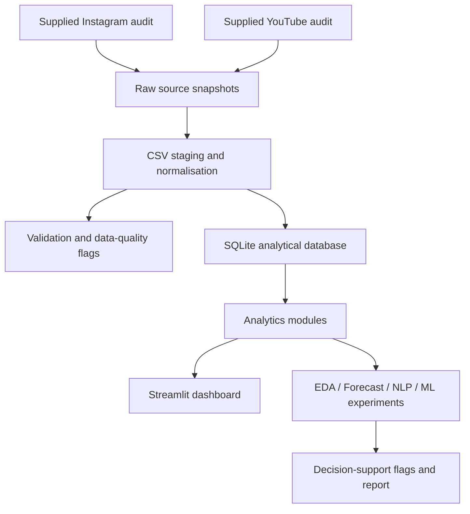

# Project Report

## 1. Title
**Social Media Intelligence & Data Analytics Platform: A Multi-Platform Data Science Study of Digital Media Performance, Audience Growth and Content Intelligence**

Organisation context: Vichar Media (news and explainers publisher)  
Platforms: Instagram and YouTube  
Project form: Applied Data Science / Business Intelligence prototype

## 2. Problem statement
Digital publishers receive performance data from different platforms, each with distinct metrics, formats and reporting windows. Analysing these datasets separately makes it difficult to compare content formats, understand audience acquisition, detect high-performing content and make evidence-informed decisions. The project creates a repeatable pipeline and dashboard that standardises the supplied data while preserving differences in metric definitions and data coverage.

## 3. Objectives
- Ingest the supplied platform audit datasets into a common structure.
- Clean and standardise dates, numeric fields, formats and missing values.
- Preserve data provenance and identify inconsistencies.
- Build an SQLite analytical store.
- Create a dashboard for account, content, traffic and time-series analysis.
- Conduct EDA to understand distributions, outliers and metric relationships.
- Experiment with baseline forecasting, text clustering and content-view modelling.
- Convert the available evidence into descriptive decision-support flags.

## 4. Data sources and scope

### Instagram
- 35 Reels and 8 carousels with post-level metrics (43 feed items).
- 32 archived Stories with Story-level metrics.
- 27 daily account insight observations from 2026-10-23 through 2026-11-19.
- Rolling 7-, 14-, 28- and 90-day account summaries.
- Audience activity snapshot: top two reported hours for each weekday.

### YouTube
- Lifetime channel summary as of 2026-11-21, covering 2026-06-09 to 2026-11-21.
- Format summary (Shorts, long-form, other/indirect).
- Seven listed traffic-source rows.
- An 11-item top-content shortlist (10 Shorts and one long-form video).

The YouTube content rows are not a complete upload inventory. No missing daily series, individual retention curves or demographic breakdowns are fabricated.

## 5. Architecture

## 6. Tools and technologies
- Python: orchestration and analysis.
- Pandas / NumPy: tabular processing and calculations.
- SQLite: local analytical database.
- Streamlit: interactive dashboard.
- Plotly: interactive charts.
- Scikit-learn: TF-IDF, K-Means and baseline regression experiments.
- Statsmodels is included as an optional time-series analysis dependency for future extensions.
- Pytest: automated validation tests.

## 7. Data processing methodology
1. Keep the audit reports as immutable raw source snapshots.
2. Extract each reported table into a normalised dataset.
3. Parse dates and numeric fields; map source phrases such as “No figure” to missing values rather than zero.
4. Store content, Stories, daily series, source breakdowns and platform summaries in separate tables.
5. Add provenance and completeness notes to content records.
6. Run record-count and aggregate checks.
7. Retain conflicting source totals and document each gap rather than silently changing values.

## 8. Descriptive findings from the supplied audits

### Instagram
- The supplied feed dataset contains 43 posts: 35 Reels and 8 carousels.
- Reported post-level feed totals are 891,574 views, 617,041 summed per-post accounts reached, 629,782 impressions, 43,565 likes, 1,600 comments, 6,425 shares, 3,408 saves, 1,419 reposts and 56,417 interactions.
- The October 5, 2026 Reel labelled “street interview pink kurta” has 737,214 views in the supplied table. This is a highly influential outlier in the distribution and affects averages.
- Median Reel views are reported as 2,401 in the audit, compared with a mean of approximately 25,266. The median better reflects the typical Reel in this strongly skewed sample.
- The supplied Story archive contains 32 records and 4,297 total Story views as reported in the audit.
- The daily account series' Views metric is an Instagram + Facebook aggregate according to the source, not a pure Instagram metric.

### YouTube
- Reported lifetime channel totals are 144,167 views, 70,297 engaged views, 401.29 watch hours and 200 subscribers.
- Shorts account for 143,845 reported views and 394.99 watch hours in the format table.
- Shorts Feed is the largest listed discovery source with 135,596 views (94.08% of channel lifetime views as reported in the source table).
- Among the top-content shortlist, “CJP Protest Mumbai: What Just Happened?” has the largest reported view count (22,360), while the flight-safety Short has the largest listed watch time among those rows (96.37 hours).

These are source-reported descriptive findings, not independently verified platform exports.

## 9. Exploratory analysis
The dashboard includes distribution histograms, reach-versus-interaction scatter plots and correlation matrices. Outliers are kept visible. Correlation is interpreted as association only, not as causation. Means and medians are both displayed to reveal skew.

## 10. Forecasting experiment
The daily Instagram account series has 28 observations. A seven-observation trailing-mean baseline is evaluated against a chronological holdout. The resulting forecast is a flat baseline and is explicitly labelled experimental. This sample is too short and the scope too mixed (Instagram + Facebook) for reliable seasonal forecasts or operational growth planning.

## 11. NLP experiment
TF-IDF and K-Means are applied to content title/topic text. Instagram labels are audit paraphrases rather than original captions, and YouTube records are a top-content shortlist. Resulting clusters are exploratory groupings for human review, not verified topic classifications.

## 12. Machine-learning feasibility experiment
An exploratory regression compares a median baseline with a Random Forest using only publication format, weekday and month. A chronological holdout is used. The feature set is intentionally limited to metadata available before publishing; engagement variables are excluded to avoid outcome leakage. With only 43 Instagram feed records, a highly skewed outcome and omitted creative/contextual features, this model is a feasibility demonstration only. It is not a production predictor.

## 13. Decision-support logic
The rules-based module flags posts with above-sample-relative reach or views, unusually strong share rates, or a minimum reported follow count. Thresholds are derived from this small dataset's medians. Flags suggest what to investigate next; they do not prove why a post performed as it did.

## 14. Data-quality findings
- Instagram follower snapshot: 390 in the profile lookup versus 394 in account insights.
- Instagram profile post count: 44 versus 43 returned feed rows.
- Instagram daily series has 28 rows from October 23 through November 19; source window label mentions November 20, but that date is not present as a daily row.
- YouTube format views sum to 144,109, 58 below the reported channel total of 144,167.
- YouTube engaged-view format sum is 70,298, one above channel total 70,297.
- YouTube format watch time sums to 401.27 hours, 0.02 hour below the channel total of 401.29.
- YouTube traffic sources sum to 143,924 views, 243 below the channel total.
- One YouTube shortlist row is malformed and lacks a net-subscriber value.
- YouTube's supplied individual content list is not exhaustive.

See `data/processed/data_quality_issues.csv` for the formal issue register.

## 15. Limitations
- No live Meta or YouTube API access is configured.
- The dataset only reflects what was present in the two supplied audit reports.
- No raw Instagram caption corpus, complete YouTube video inventory, detailed retention curves, age/gender/geography demographics or complete source-by-video matrix is included.
- Some metrics are platform-specific or have different measurement definitions and should not be combined across platforms.
- Snapshot timing and reporting periods vary.
- Short time series and small content samples make modelling results exploratory.

## 16. Future improvements
1. Obtain official Instagram and YouTube CSV exports and append them with extraction timestamps.
2. Introduce stable platform content IDs and a `metric_observation` fact table keyed by content, date, metric and source.
3. Automate scheduled exports/API ingestion only where authorised and supported by platform policy.
4. Add a dimension table for editorial topics and content formats, with manual review.
5. Collect pre-publication features (duration, hook type, topic, format, post time, caption length) to support valid predictive experiments.
6. Add audience retention and traffic-source-by-video data when available.
7. Add role-based access, refresh logs and a model registry if the prototype moves beyond local use.

## 17. Conclusion
The prototype demonstrates an end-to-end workflow from raw platform audit snapshots to cleaned data, quality checks, a relational store, interactive dashboards and carefully caveated analytical experiments. Its key strength is transparent handling of data provenance, gaps and inconsistencies rather than false precision.
